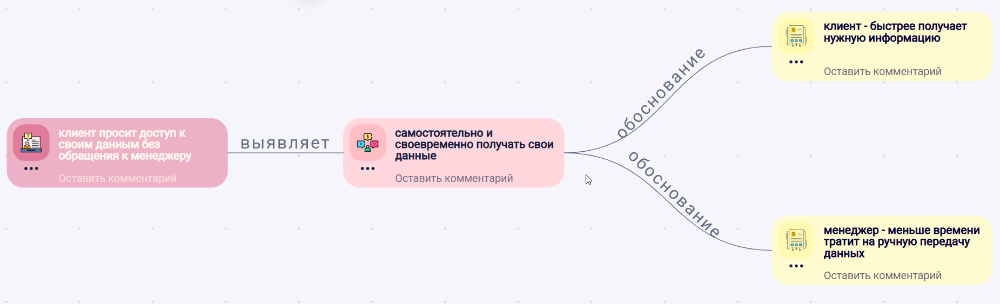
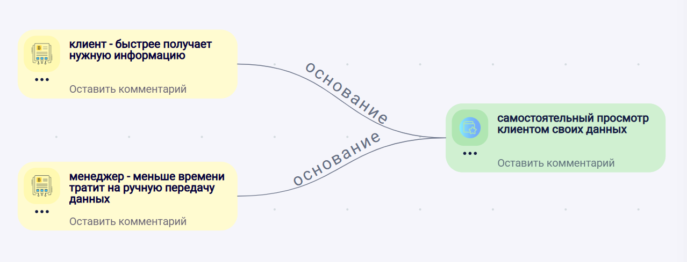
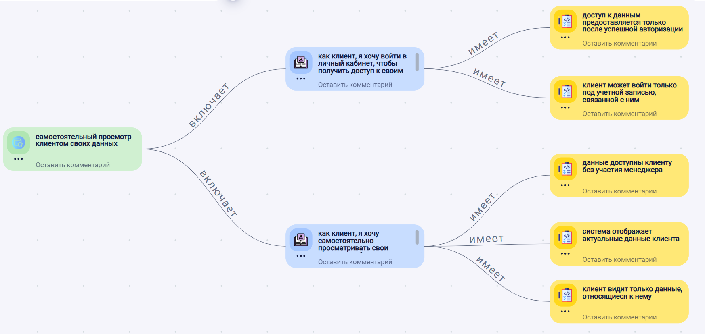
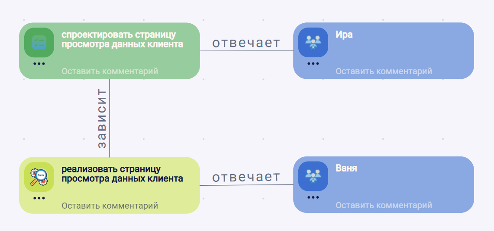
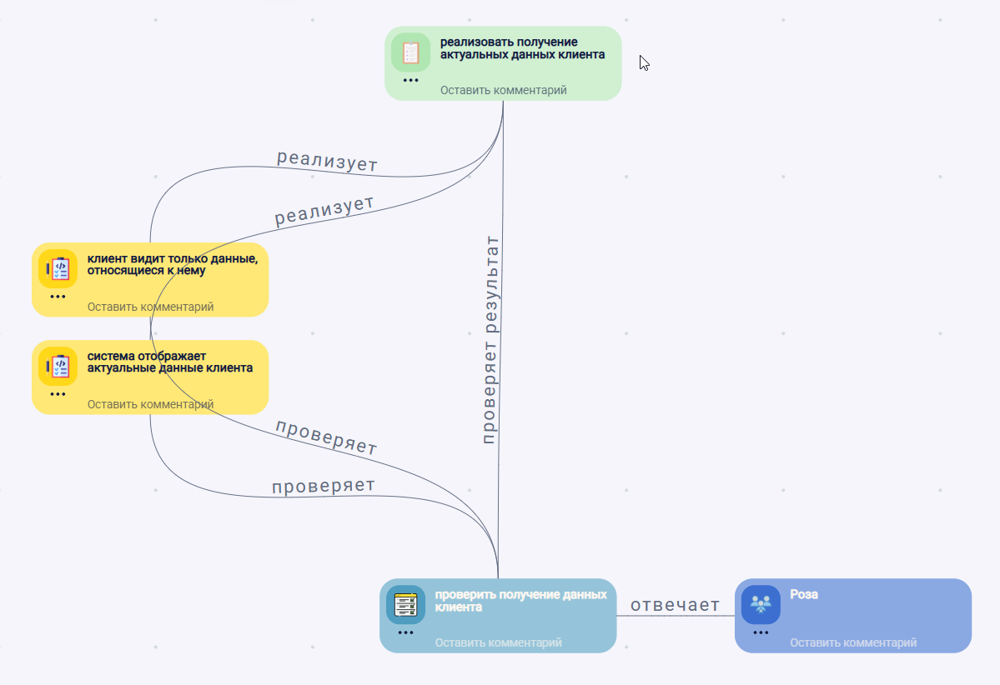
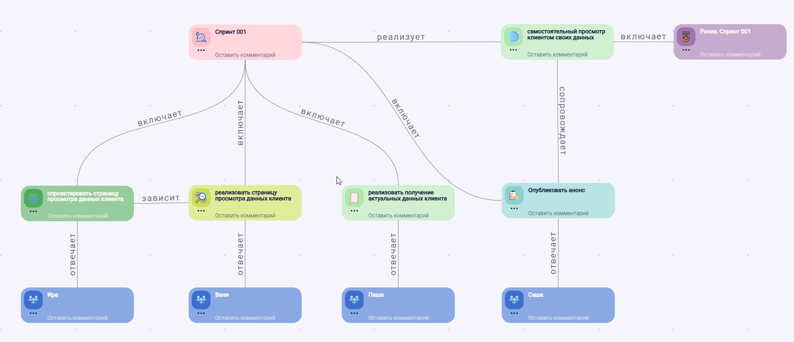

# Методология ведения проекта разработки ПО

Статус: публичная версия
Версия: 1.0.0
Дата публикации: 14 августа 2026 года
Владелец и правообладатель: ООО Онтонет
Лицензия: [Creative Commons Attribution 4.0 International (CC BY 4.0)](https://creativecommons.org/licenses/by/4.0/)

## Структура документа

1. Назначение и область применения
2. Методы и процесс работы
3. Роли и ответственность
4. Результаты, готовность и контроль
5. Адаптация методологии
6. Реализация в Онто
7. Глоссарий и приложения

## 1. Назначение и область применения

Документ описывает практический подход к ведению проекта разработки ПО: как команда превращает идеи, запросы и проблемы в понятные изменения продукта и доводит их до реализации, проверки и выпуска.

Ценность методологии в том, что при должном применении она помогает команде видеть общую картину разработки и не терять смысл работы по мере движения от идеи к реализации. Каждый участник понимает, зачем выполняет свою часть работы и как она связана с общим результатом.

Методология не задает единственно правильный способ управления проектом и не заменяет существующие процессы команды. Ее задача - дать общий каркас, который помогает участникам договориться о понятиях, связях, состояниях и критериях готовности работы.

Документ может быть полезен командам, которые хотят сделать разработку более прозрачной: сохранять контекст работы, видеть её связь с ожидаемым результатом и понимать, как она движется от появления запроса до выпуска.

Подход применим в продуктовых и проектных командах, которые разрабатывают или развивают программные продукты. При этом методология требует адаптации под размер команды, зрелость процессов, тип продукта, регуляторные ограничения и уже принятые способы планирования и разработки.

Подход не привязан к конкретному инструменту. В документе Онто используется как прикладной пример реализации.

## 2. Методы и процесс работы

Процесс применяется к работе любого масштаба. Большая работа может быть разделена на составляющие, каждая из которых рассматривается как отдельная работа со своим ожидаемым результатом и критериями его достижения. В свою очередь, такая работа может быть разделена дальше. Благодаря связям между уровнями декомпозиции сохраняется понимание того, какой вклад каждая составляющая вносит в общий результат.

Для рассматриваемой работы определяются ожидаемый результат и критерии его достижения. Работа считается завершенной, когда результат достигнут и выполнение критериев подтверждено. Завершение составляющих работ помогает достичь результата более крупной работы, но само по себе не подтверждает его достижение.

Типовой путь работы можно представить так: основание для работы -> обоснование -> ожидаемое изменение -> сценарии и требования -> декомпозиция -> выполнение -> проверка критериев -> завершение результата -> обратная связь.

Глубина декомпозиции и состав отдельно фиксируемых элементов определяются с учетом характера работы. Этапы могут объединяться или уточняться. На уровне, который в проекте рассматривается как выпускаемый результат, завершение работы фиксируется как выпуск.

### 2.1. Основание для работы

Основание для работы - это причина, по которой начинается рассмотрение возможного изменения. Это еще не готовая задача и не готовое решение, а повод разобраться, требует ли ситуация дальнейшей проработки.

В методологии "основание для работы" используется как обобщающее понятие. В конкретном проекте команда сама определяет, какие виды оснований для нее значимы и как они фиксируются.

На этом этапе важно сохранить исходный контекст в объеме, который позволит понять значимость основания: что произошло или было замечено, откуда пришла информация и почему на нее стоит обратить внимание. Если контекст неясен, основание требует уточнения, а не немедленного перехода к реализации.

По результатам первичного рассмотрения принимается решение о дальнейшем движении основания: продолжить проработку, объединить с похожими обращениями, отложить, отклонить или передать в другой рабочий контур.

### 2.2. Обоснование изменения

Обоснование изменения объясняет, почему зафиксированное основание стоит переводить в дальнейшую проработку. Оно связывает исходное основание с ожидаемым результатом и помогает участникам понять, зачем нужно изменение.

На этом этапе уточняется, какую потребность, цель, риск или обязательство необходимо закрыть. Если основание пришло в виде предложения конкретного решения, обоснование помогает отделить предложенный вариант от причины, которая за ним стоит. Например, запрос на новую кнопку может отражать более широкую потребность пользователя быстрее выполнять действие или лучше видеть состояние процесса.

Обоснование не должно сразу описывать детальную реализацию. Его задача - зафиксировать, какой результат нужен пользователю, бизнесу, команде или системе, и почему этот результат важен. После этого можно переходить к выбору подходящего изменения продукта, процесса или технического решения.

По результатам проработки обоснование может быть подтверждено, уточнено, отложено или отклонено. Если обоснование подтверждено, оно становится основой для определения ожидаемого изменения и дальнейшей работы.

### 2.3. Ожидаемое изменение

После того как обоснование сформулировано, определяется, что должно измениться для достижения ожидаемого результата. Изменение может относиться к продукту, процессу, системе или другой области, затронутой работой. Его конкретное содержание зависит от основания и обоснования.

Ожидаемое изменение отвечает на вопрос «что должно измениться?». Оно фиксирует необходимое отличие от текущего состояния, но не требует описания детальной реализации.

Изменение сохраняет связь с обоснованием, из которого оно появилось. Это помогает участникам не терять исходный смысл работы и позднее проверить, привело ли изменение к ожидаемому результату.

После формулирования изменения принимается решение, достаточно ли оно понятно для дальнейшей проработки или требует уточнения, пересмотра либо отказа от выбранного направления.

### 2.4. Сценарии и требования

Ожидаемое изменение может быть уточнено через сценарии и требования. Они помогают описать ожидаемое поведение, условия его выполнения и границы реализации. Необходимые состав и глубина описания определяются исходя из характера работы.

Сценарии показывают, как ожидаемое изменение проявляется на практике: в каких условиях происходит действие или взаимодействие и какой результат должен быть получен. Форму и подробность сценариев команда выбирает под свой процесс.

Требования фиксируют условия и ограничения, которые необходимо выполнить, чтобы ожидаемое изменение можно было реализовать, а полученный результат — проверить. Состав требований зависит от характера изменения и области, которую оно затрагивает.

Сценарии и требования сохраняют связь с ожидаемым изменением и уточняют его содержание. Они становятся основой для дальнейшей работы и проверки результата.

Перед продолжением работы принимается решение, достаточно ли понятны сценарии и требования или их необходимо уточнить.

### 2.5. Задачи

Выполнение можно организовать с помощью отдельных задач. Команда сама определяет, когда нужны отдельные задачи и насколько подробно их описывать. Задачи можно планировать, выполнять и отслеживать.

Задача сохраняет связь с тем, ради чего появилась: ожидаемым изменением, сценарием, требованием или другим элементом контекста. Благодаря этой связи участники понимают причину появления задачи и ее место в общей работе.

Перед выполнением задачи должно быть понятно, какой результат от нее ожидается и по каким признакам он будет принят. Завершение задачи означает, что достигнут ее ожидаемый результат, но само по себе не подтверждает достижение результата более крупной работы.

Задача может быть связана с элементами продукта или системы, которые она создает, изменяет или использует. Это помогает видеть область воздействия работы.

Значимые зависимости между задачами фиксируются, чтобы участники могли видеть возможные блокировки и учитывать их при организации выполнения.

Перед началом выполнения принимается решение, достаточно ли описана задача и хватает ли связанного с ней контекста для получения ожидаемого результата.

### 2.6. Выполнение

Выполнение направлено на получение ожидаемого результата. Оно начинается, когда участникам хватает контекста для работы и понятно, по каким признакам будет оцениваться результат.

Команда сама выбирает способ организации выполнения. Для этого могут использоваться задачи, спринты, итерации, непрерывный поток или другой подход, принятый в проекте.

Во время выполнения должна сохраняться прозрачность хода работы: участникам должны быть видны текущее состояние, значимые зависимости, блокировки и решения, влияющие на результат. Способ и подробность их фиксации команда определяет под свой процесс.

Если в ходе выполнения обнаруживается недостаток контекста, меняются условия или возникают другие обстоятельства, влияющие на ожидаемый результат, дальнейшие действия пересматриваются. Работа может быть продолжена после уточнения, приостановлена или изменена с учетом новой информации.

Технические ограничения, риски и долг, выявленные во время выполнения, учитываются при принятии решений по текущей работе. Если они требуют отдельного рассмотрения, они фиксируются как новые основания для работы.

### 2.7. Проверка

Проверка нужна для того, чтобы подтвердить достижение ожидаемого результата рассматриваемой работы и выполнение критериев его достижения.

Полученный результат сопоставляется с установленными для него критериями. Связанные элементы контекста помогают понять, что и почему необходимо проверить, а результаты составляющих работ могут использоваться как подтверждения.

Проверка не сводится только к поиску ошибок. Ее способ и глубина определяются с учетом характера результата, возможных последствий и необходимой уверенности в его достижении.

Завершение составляющих работ и результаты проведенных для них проверок сами по себе не подтверждают достижение более крупного результата. Он оценивается по критериям, определенным для рассматриваемого уровня.

Если критерии выполнены, достижение результата может быть подтверждено и работа считается завершенной на рассматриваемом уровне. Если критерии не выполнены или подтверждений недостаточно, работа остается незавершенной, а дальнейшие действия определяются в соответствии с принятым процессом.

Выявленные расхождения и новые обстоятельства фиксируются и связываются с соответствующим контекстом. Если они требуют отдельного рассмотрения, они могут стать новыми основаниями для работы.

### 2.8. Выпуск

На уровне, который в проекте рассматривается как выпускаемый результат, подтвержденное завершение работы фиксируется как выпуск. Выпуск означает, что ожидаемый результат этого уровня достигнут и установленные для него критерии выполнены.

Команда сама определяет, какой уровень работы считать выпускаемым и как фиксировать выпуск. Включение кода в версию продукта, техническое развертывание, передача результата или его доступность могут входить в критерии выпуска, но не являются универсальными условиями и сами по себе не определяют его наступление.

Фиксация выпуска должна позволять понять, какой результат признан достигнутым, на основании чего принято это решение и как он связан с исходным контекстом. Значимые ограничения и известные риски сохраняются вместе с информацией о выпуске.

Решение о выпуске должно быть явным. Если критерии не подтверждены или подтверждений недостаточно, результат на рассматриваемом уровне не считается выпущенным, а дальнейшие действия определяются в соответствии с принятым процессом.

Обратная связь после выпуска может подтвердить ожидаемый результат, выявить расхождения или стать новым основанием для работы. Поэтому выпуск завершает рассматриваемую работу, но не исключает появления следующей.

### 2.9. Обратная связь

Обратная связь показывает, к чему привел выпущенный результат в последующих условиях, подтвердились ли исходные предположения и появилась ли новая информация, требующая внимания участников.

Источники, форму и способ получения обратной связи команда определяет с учетом характера результата и затронутых участников.

Если обратная связь подтверждает ожидаемый эффект результата, это связывается с соответствующим выпуском. Выявленные расхождения, новые ограничения или потребности также сохраняют связь с выпуском и могут стать уточнением существующего контекста или новым основанием для работы.

Обратная связь не отменяет принятое решение о выпуске, но может показать, что оно было основано на недостаточной информации либо что результат или критерии требуют пересмотра.

Таким образом, обратная связь связывает завершенную работу с последующей и позволяет сохранить контекст между полученным результатом и новыми основаниями для работы.

## 3. Роли и ответственность

Описанного процесса недостаточно, если участникам непонятно, кто выполняет работу, отвечает за ее результат, подтверждает выполнение необходимых условий или достижение результата и принимает решения о дальнейшем движении или завершении. Распределение ответственности определяется для каждой работы на рассматриваемом уровне с учетом ее характера и условий организации процесса.

Методология описывает функции, а не устанавливает обязательный набор должностей или постоянных ролей. Один участник может выполнять несколько функций, а в выполнении одной функции могут участвовать несколько участников или команд. Такое совмещение или распределение функций не отменяет необходимости определить точку принятия окончательного решения для решения, влияющего на дальнейшее движение или завершение конкретной работы.

### 3.1. Функции участников

Для конкретной работы определяется состав функций, необходимый для ее организации и принятия решений. В зависимости от характера работы функции могут совмещаться, распределяться между несколькими участниками или командами и дополняться. В качестве основы могут использоваться следующие функции:

- источник предоставляет исходную информацию и контекст работы, но не обязательно участвует в ее дальнейшем выполнении;
- исполнитель выполняет работу, направленную на получение ожидаемого результата;
- ответственный за результат отвечает за достижение ожидаемого результата на рассматриваемом уровне и координирует необходимую для этого работу;
- подтверждающий условия или результат сопоставляет доступные подтверждения с условиями готовности или критериями достижения результата и формулирует заключение;
- принимающий решение в пределах своих полномочий принимает окончательное решение о дальнейшем движении или завершении работы.

Один участник может выполнять несколько функций, а в выполнении одной функции могут участвовать несколько участников или команд. Для разных решений принимающие окончательное решение могут различаться. Участие в выполнении работы, ответственность за результат или его подтверждение сами по себе не означают полномочия принять окончательное решение.

### 3.2. Фиксация ответственности

Распределение функций и полномочий должно быть понятно участникам в объеме, необходимом для организации конкретной работы. Если несколько функций совмещены или их распределение очевидно и устойчиво, методология не требует фиксировать каждую функцию отдельно.

Для решений, влияющих на дальнейшее движение или завершение работы, точка принятия окончательного решения должна оставаться однозначной. Если функции распределены между разными участниками, должны быть понятны границы их ответственности и полномочий. В частности, заключение о выполнении условий или достижении результата следует отличать от окончательного решения, если их принимают разные участники.

Способ и подробность фиксации выбираются с учетом характера работы. Распределение функций может быть отражено в описании процесса или работы, записи о решении, таблице ответственности, связанной модели проекта либо иным подходящим способом. Отдельный формальный документ не требуется. Информация фиксируется там, где без нее участники могут по-разному понимать ответственность, полномочия или основание принятого решения.

## 4. Результаты, готовность и контроль

Готовность и завершение работы определяются не изменением состояния и не прохождением установленного набора этапов. Для рассматриваемой работы определяются ожидаемый результат, критерии его достижения и способ подтверждения.

Готовность означает, что выполнены условия, определенные для начала или продолжения работы. Завершение означает, что ожидаемый результат достигнут и выполнение его критериев подтверждено. Состояния могут отражать принятые решения, но сами по себе не являются подтверждением готовности или завершения.

Этот принцип применяется к работе любого масштаба. Содержание критериев и способ их подтверждения выбираются с учетом характера результата и условий, в которых он должен быть достигнут.

### 4.1. Условия готовности и критерии достижения результата

Для завершения рассматриваемой работы определяются критерии достижения ожидаемого результата. Они описывают признаки, по которым можно подтвердить, что результат получен на этом уровне.

При необходимости отдельно определяются условия готовности к началу или продолжению работы. Они показывают, что должно быть выполнено перед началом выбранного действия.

Условия и критерии не обязательно оформлять как отдельные формальные перечни. Способ и подробность их фиксации выбираются с учетом характера работы. Важно, чтобы участникам было понятно, на каком основании принимаются решения о готовности и завершении.

Состояния, заполненные поля и завершение составляющих работ могут использоваться как подтверждения, но не заменяют оценку ожидаемого результата по определенным для него критериям.

### 4.2. Подтверждение готовности и завершения

Решения о готовности к началу или продолжению работы и о ее завершении должны быть явными и понятными участникам. Готовность оценивается на основании определенных для нее условий, а достижение результата — на основании установленных критериев.

Выполнение условий или достижение результата могут подтверждать один или несколько участников либо команд. Их заключение используется как основание для соответствующего решения. Если функции подтверждающего и принимающего решение разделены, такое заключение само по себе не означает, что окончательное решение принято. Изменение состояния может отражать принятое решение, но не заменяет его.

Для каждого решения, влияющего на начало, продолжение или завершение работы, должна быть понятна точка принятия окончательного решения. Если выполнение условий или достижение результата не подтверждено, дальнейшие действия определяются в соответствии с принятым процессом. Если используются отдельно выделенные этапы, решения о переходах между ними принимаются по тем же правилам.

### 4.3. Контроль связей и полноты

Контроль помогает обнаруживать потерянные связи, противоречия, недостаточные критерии или подтверждения и случаи, когда изменение состояния ошибочно принято за достижение результата. Особое внимание уделяется связям между результатами разных уровней и вкладу составляющих работ в более крупный результат. Команда сама определяет способы, глубину и периодичность контроля. Контроль применяется по ходу работы и после выпуска с учетом полученной обратной связи. Если выявлено несоответствие, определяется, что требует уточнения, исправления или пересмотра и остается ли принятое решение о готовности или завершении обоснованным. Методология не требует обязательного возврата на определенный этап.

## 5. Адаптация методологии

Методология может быть адаптирована к условиям конкретного проекта или организации. Адаптация меняет глубину и форму процесса, но не должна лишать участников возможности понять, почему появилась работа, какой результат ожидался и на каком основании он был подтвержден.

Цель адаптации — организовать работу и сохранить достаточную трассируемость без формального прохождения полного маршрута и избыточной детализации. Границы адаптации определяются инвариантами методологии, которые должны сохраняться при любом выбранном варианте процесса.

### 5.1. Инварианты методологии

Адаптация не меняет основные принципы методологии. Работа сохраняет связь с основанием и контекстом своего появления, а решения и результаты — с работой, к которой они относятся. Если работа является составляющей более крупной работы, сохраняется связь между их результатами.

Завершение работы определяется достижением ожидаемого результата на рассматриваемом уровне. Этапы, состояния, документы и завершение составляющих работ могут использоваться для организации процесса и подтверждения принятых решений, но не заменяют оценку самого результата.

Состав участников и распределение функций могут различаться. При этом для каждого решения, влияющего на дальнейшее движение или завершение конкретной работы, должна оставаться понятной точка принятия окончательного решения. Для разных решений такие точки могут различаться.

### 5.2. Границы адаптации

В пределах установленных инвариантов могут изменяться глубина описания, состав отдельно фиксируемых элементов, способ организации процесса, правила принятия решений и переходов между этапами, если такие этапы используются, а также способы фиксации информации и контроля.

Конкретный вариант выбирается с учетом характера работы, уровня неопределенности, рисков, зависимостей, количества участников и других значимых условий. Для одной работы может быть достаточно короткого маршрута, для другой потребуется более подробная проработка. Выбранный вариант может меняться по мере уточнения работы и появления нового контекста.

Граница адаптации проходит там, где упрощение начинает нарушать инварианты методологии. Адаптация не требует одинаковой глубины процесса для всех работ или формального воспроизведения типового пути.

### 5.3. Минимально достаточная трассируемость

Минимально достаточная трассируемость определяется не количеством отдельно зафиксированных элементов и не соответствием типовому пути, а сохранением инвариантов методологии для конкретной работы. Она должна поддерживаться по ходу работы и после ее завершения.

Для простой и понятной работы контекст может быть сохранен несколькими непосредственными связями. По мере роста неопределенности, количества зависимостей или уровней декомпозиции могут потребоваться дополнительные элементы и связи. Их объем должен быть достаточен для сохранения контекста, взаимосвязи результатов и оснований принятых решений, но не для формальной полноты модели.

Трассируемость достаточна, если участники могут восстановить причину появления работы, сопоставить выполненные изменения с ожидаемым и полученным результатом и понять основание решения о завершении. Если необходимые для этого связи теряются, процесс требует уточнения в той части, где утрачен контекст.

### 5.4. Пример применения и адаптации

Ниже приведён один из возможных вариантов применения методологии. Он показывает, как глубина процесса может изменяться по мере появления нового контекста, не превращая выбранный маршрут в обязательный для другой работы.

Пользователи иногда повторно отправляют заявку, потому что не понимают, была ли она принята и продолжается ли её обработка. Основанием для работы становятся обращения пользователей и обнаруженные повторные заявки. Ожидаемый результат состоит в том, чтобы пользователь понимал состояние заявки, а повторное действие не создавало нежелательный повторный результат.

Сначала участники предполагают, что причина заключается только в недостаточно понятном отображении состояния. Работа выглядит локальной, ожидаемое поведение понятно, а риск оценивается как невысокий. Поэтому основание, ожидаемое изменение, необходимая работа и критерии её завершения могут быть зафиксированы вместе, без выделения дополнительных элементов процесса. Отдельная подробная проработка не требуется, пока она не помогает принять решение или подтвердить результат.

При уточнении выясняется, что повторная заявка может появиться не только из-за повторного действия пользователя, но и после потери соединения, повторной отправки или одновременного выполнения действия из разных мест. Теперь недостаточно только понятнее показать состояние обработки. Необходимо также подтвердить, что повторное обращение не создаёт нежелательный повторный результат.

Маршрут не заменяется другим, и работа не начинается заново. К уже сохранённому основанию добавляется новый контекст, а глубина описания увеличивается там, где обнаружены неопределённость и риск. Участники уточняют ожидаемый результат, отдельно рассматривают значимые сценарии, определяют условия выполнения и проверки, выявляют зависимости и связывают составляющие работы с общим результатом.

Работы над отдельными частями решения могут завершаться и проверяться независимо. Однако их завершение само по себе не подтверждает достижение результата всей работы. Например, понятное отображение состояния заявки ещё не доказывает, что повторное обращение не создаёт второй результат.

Результат рассматриваемого уровня может быть признан достигнутым, когда подтверждено, что пользователь получает понятную информацию о состоянии заявки, нежелательные повторные заявки не создаются, а допустимая отправка новой заявки не блокируется. Конкретный состав критериев и способ их подтверждения участники определяют с учётом контекста проекта.

При изменении глубины процесса сохраняются инварианты методологии: связь с основанием работы, понимание ожидаемого результата, связь составляющих работ с общим результатом, критерии его достижения и понятная точка принятия окончательного решения. Если бы дополнительная неопределённость и риск не обнаружились, первоначального короткого маршрута было бы достаточно.

## 6. Реализация в Онто

Этот раздел показывает один из вариантов реализации методологии в Онто. Элементы работы представляются объектами, их характеристики задаются с помощью шаблонов, а связи между объектами сохраняют контекст и трассируемость. Это прикладная реализация методологии, а не обязательная для неё структура или единственный способ использования Онто.

### 6.1. Связанная модель и способы работы с ней

Для применения методологии участники определяют границу связанной модели в Онто. Такой границей выступает пространство. Оно может охватывать продукт, проект, направление или другую выбранную область работы.

Внутри пространства элементы работы, принятые решения и полученные результаты фиксируются объектами. Шаблоны используются, когда объекты нужно классифицировать и описывать по общей структуре. Какие элементы представлять отдельными объектами, какие шаблоны применять и какие свойства сохранять, участники определяют под свой контекст.

Связи объединяют объекты в модель и позволяют восстановить путь от причины появления работы до результата. Типы возможных связей настраиваются между соответствующими шаблонами. Участники могут использовать существующие шаблоны и связи или настраивать необходимые для своей модели. Состояния объектов могут дополнительно отражать принятые решения и движение работы, если это требуется выбранному процессу.

С общей моделью можно работать тремя способами:

- визуально - на диаграммах, где участники видят объекты, связи между ними и выбранный контекст модели;
- таблично - в виде структурированного набора объектов и их свойств, который удобно просматривать, фильтровать, сопоставлять и изменять;
- текстово - через взаимодействие с AI-ассистентами, которым можно задавать вопросы о модели, поручать поиск и объяснение связей, а также создание или изменение её элементов.

Эти способы не образуют отдельные хранилища. Объекты и связи относятся к общей модели пространства, а визуальное, табличное и текстовое представления позволяют работать с ней с разных сторон. На диаграмме создается представление объекта, при этом сам объект остается частью пространства и может быть представлен на нескольких диаграммах. Изменения, внесенные одним способом, становятся частью общей модели и доступны при работе с ней другими способами.

Определения используемых понятий приведены в разделе 7.

### 6.2. Сквозной пример применения

Ниже показан один из возможных способов применить методологию в Онто. Клиент хочет получать свои данные самостоятельно, без обращения к менеджеру. Участникам, которые развивают продукт, нужно превратить этот запрос в проверенный результат, не потеряв по пути потребность клиента и основания принятых решений.

Пример построен как последовательный рецепт. Каждый шаг объясняет, зачем нужен его результат, как получить этот результат с помощью Онто и что должно появиться в связанной модели. Описанные действия выполняются на уровне модели и могут осуществляться визуально, таблично или текстово.

Используемые объекты, шаблоны и связи представляют один из вариантов настройки Онто. В другом проекте состав объектов и глубина описания могут отличаться: отдельные шаги можно объединять или уточнять при сохранении инвариантов методологии.

Основное внимание в примере уделено объектам и связям между ними. Состояния объектов могут дополнительно использоваться для отражения принятых решений и движения работы. Переходы состояний на диаграммах не показаны, чтобы не перегружать модель; их набор и правила определяются под процесс проекта.

**Шаг 1. Фиксируем запрос и его источник**

**Зачем.** Участнику, который принимает обращение, важно сохранить исходную формулировку запроса и понимать, от кого он поступил. Это позволяет вернуться к исходному контексту и не подменить потребность клиента предположением о готовом решении.

**Как в Онто.** Запрос фиксируется объектом с шаблоном `Запрос`. В этом примере источником выступает роль клиента, поэтому создаётся объект `Клиент` с шаблоном `Роль пользователя`. Чтобы связать запрос с его источником, в выбранной для примера модели между шаблонами `Запрос` и `Роль пользователя` настраивается отношение `источник`.

**Результат.** В модели появляется запрос, связанный с ролью пользователя, от которой он поступил. Этого достаточно, чтобы перейти к выяснению потребности и ожидаемой ценности.

`Запрос — источник → Роль пользователя «Клиент»`

**Шаг 2. Связываем запрос с потребностью и ценностью**

**Зачем.** Запрос описывает, чего просит клиент, но сам по себе не объясняет, какой результат ему нужен и почему он важен. Участнику необходимо понять потребность клиента и ожидаемую ценность для затронутых людей, чтобы не выполнить формальный запрос, не решив стоящую за ним проблему.

**Как в Онто.** Выявленная потребность фиксируется объектом с шаблоном `Потребность`, а ожидаемые преимущества — объектами с шаблоном `Ценность`. Чтобы сохранить переход от запроса к его обоснованию, в выбранной для примера модели между шаблонами `Запрос` и `Потребность` настраивается отношение `выявляет`, а между шаблонами `Потребность` и `Ценность` — отношение `обоснование`. После этого запрос, потребность и ценности связываются соответствующими отношениями. В этом примере клиент быстрее получает нужную информацию, а менеджер тратит меньше времени на ручную передачу данных.

**Результат.** По настроенным для примера связям запрос связан с потребностью и ожидаемыми ценностями. Теперь понятно, зачем требуется дальнейшая работа и какой эффект должен дать её результат.

`Запрос — выявляет → Потребность — обоснование → Ценность`

**Шаг 3. Формируем возможность**

**Зачем.** Потребность и ценность объясняют, почему изменение важно, но ещё не определяют, что именно должно измениться в продукте. Участнику необходимо сформулировать ожидаемое изменение, чтобы направить дальнейшую проработку на конкретный результат, не переходя преждевременно к деталям реализации.

**Как в Онто.** Ожидаемое изменение фиксируется в объекте с шаблоном `Возможность`. В рамках выбранной для примера модели объект связывается отношением `основание` с ценностями, ради которых выполняется работа. В этом примере возможность описывает самостоятельный просмотр клиентом своих данных. Если несколько возможностей относятся к общей области развития, их можно связать с объектом `Направление развития` отношением `раскрывает`. В данном примере отдельное направление не требуется.

**Результат.** В модели появляется возможность, связанная с ожидаемыми ценностями. Теперь понятно, что должно измениться и на каком основании это изменение выбрано. При использовании направления также видно, какую область развития раскрывает возможность.

`Ценность — основание → Возможность`

При необходимости:

`Направление развития — раскрывает → Возможность`

**Шаг 4. Связываем возможность с пользовательскими потребностями, сценариями и требованиями**

**Зачем.** Возможность обозначает ожидаемое изменение, но ещё не объясняет, какую потребность пользователя она закрывает, как должна проявляться в поведении и при каких условиях результат можно будет принять. Участнику необходимо сделать ожидаемое поведение понятным и проверяемым до начала реализации.

**Как в Онто.** Потребность пользователя фиксируется объектом с шаблоном `Пользовательская потребность` и связывается с возможностью отношением `описывает`. Ожидаемое поведение фиксируется объектами с шаблоном `Сценарий исполнения`, которые связываются с пользовательской потребностью отношением `конкретизируется`. Условия и ограничения фиксируются объектами с шаблоном `Требование`. Требование связывается отношением `условие` с возможностью или сценарием исполнения — в зависимости от того, к какому уровню относится условие.

**Результат.** Возможность связана с пользовательскими потребностями, сценариями исполнения и требованиями. В модели видно, для кого и зачем нужна возможность, как она должна проявляться и какие условия необходимо выполнить и проверить.

`Возможность — описывает → Пользовательская потребность — конкретизируется → Сценарий исполнения`

`Требование — условие → Возможность`

или

`Требование — условие → Сценарий исполнения`

**Шаг 5. Связываем требования с задачами и затронутыми элементами**

**Зачем.** Требования описывают условия ожидаемого результата, но исполнителям необходимо понять, какую работу предстоит выполнить и какие части системы она затронет. Это позволяет организовать выполнение, не потеряв связь задач с причиной их появления.

**Как в Онто.** Единицы выполнения фиксируются как объекты с шаблонами задач, подходящими для соответствующей области работы. Каждая задача связывается отношением `реализует` с требованиями, ради которых она выполняется. В текущей модели Онто задача может связываться с объектом `Элемент интерфейса` отношениями `создает` и `изменяет`. В этом примере такие связи показывают, какие элементы интерфейса появятся или изменятся при выполнении задач. Другие затронутые части системы могут быть представлены подходящими шаблонами и отношениями, настроенными для конкретного проекта, но в этом примере они не уточняются.

**Результат.** В модели видно, какие задачи реализуют требования и какие элементы интерфейса они создают или изменяют. Исполнитель может понять ожидаемый вклад задачи и подтверждённую моделью область её воздействия.

`Требование ← реализует — Задача`

`Задача — создает → Элемент интерфейса`

`Задача — изменяет → Элемент интерфейса`

**Шаг 6. Передаём задачи в выполнение**

**Зачем.** Исполнителю необходимо понимать, за какую работу он отвечает и от каких результатов зависит её начало или продолжение. Это позволяет согласовать выполнение и вовремя увидеть препятствия, которые мешают получить ожидаемый результат.

**Как в Онто.** Участник связывается с задачей отношением `исполнитель`. Если результат одной задачи необходим для начала или продолжения другой, блокирующая задача связывается с зависимой отношением `блокирует`. Принятые решения о начале и ходе выполнения могут отражаться состояниями задач, выбранными для процесса проекта.

**Результат.** В модели видны исполнители задач, блокирующие зависимости и текущее движение работы. Участники могут определить доступную им работу и увидеть препятствия, мешающие её продолжению.

`Участник — исполнитель → Задача`

`Задача — блокирует → Задача`

**Шаг 7. Проверяем результат**

**Зачем.** Завершение задач реализации само по себе не подтверждает достижение ожидаемого результата. Участнику, который подтверждает результат, необходимо получить свидетельства выполнения требований и понять, действительно ли выполненная работа дала нужный результат.

**Как в Онто.** Проверка фиксируется как задача с подходящим шаблоном и связывается отношением `проверяет` с требованиями, выполнение которых необходимо подтвердить. Задачи реализации уже связаны с этими требованиями отношением `реализует`, поэтому по модели можно восстановить, результаты каких работ относятся к проверке. Участник, выполняющий проверку, связывается с задачей отношением `исполнитель`. Полученные свидетельства и заключение фиксируются в задаче проверки.

**Результат.** В модели видно, какие требования проверены, какие задачи обеспечили проверяемый результат, на каких свидетельствах основано заключение и кто выполняет проверку. Заключение становится основанием для отдельного решения о выпуске, но не заменяет его.

`Задача проверки — проверяет → Требование ← реализует — Задача`

`Участник — исполнитель → Задача проверки`

**Шаг 8. Формируем выпуск**

**Зачем.** После подтверждения результата участнику, принимающему решение о выпуске, необходимо явно зафиксировать, какой результат признан достигнутым и на каком основании принято это решение. Это не позволяет спутать завершение отдельных задач или спринта с выпуском результата рассматриваемой работы.

**Как в Онто.** Выпуск фиксируется объектом с шаблоном `Релиз` после принятия окончательного решения. Чтобы реализовать выбранную для примера модель трассируемости, для релиза настраиваются отношения с задачей проверки, участником, принимающим решение, и выпускаемой возможностью. В примере они называются `основание`, `принимает решение` и `включает`. После принятия решения задача проверки, участник и возможность связываются с объектом релиза соответствующими отношениями. Если выполнение организовано спринтами, объект `Спринт` связывается с входящими в него задачами существующим отношением `включает`. Спринт показывает организацию выполнения, но не заменяет выпуск.

**Результат.** В модели отдельно представлены организация выполнения и зафиксированный выпуск. По настроенным для примера связям видно, какая возможность выпущена, на основании какого заключения принято решение и кто принял окончательное решение. Состав спринта показывает, какие задачи выполнялись в рамках соответствующего периода работы.

`Задача проверки — основание → Релиз`

`Участник — принимает решение → Релиз`

`Релиз — включает → Возможность`

`Спринт — включает → Задача`

**Шаг 9. Фиксируем обратную связь**

**Зачем.** После выпуска участникам важно понять, дал ли результат ожидаемый эффект и какие новые потребности появились при его использовании. Это позволяет подтвердить ценность выполненной работы или начать следующую работу на основании фактической информации.

**Как в Онто.** Значимая обратная связь фиксируется объектом с шаблоном, соответствующим характеру полученной информации. Чтобы сохранить её связь с выпуском, в выбранной для примера модели между `Релизом` и используемыми для обратной связи шаблонами настраивается отношение `относится к`. Если обратная связь подтверждает ожидаемый эффект, эта информация сохраняется в созданном объекте вместе со связью с релизом. Если она указывает на расхождение, ограничение или новую потребность, тот же объект используется как новое основание для работы. Например, новый запрос клиента фиксируется объектом с шаблоном `Запрос`, связывается с релизом и начинает следующую цепочку проработки. Для связи запроса с выявленной потребностью в модели примера настраивается отношение `выявляет`.

**Результат.** По настроенным для примера связям видно, к какому выпуску относится обратная связь, что она сообщила о полученном результате и стала ли она основанием для следующей работы. Новое основание сохраняет связь с выпуском, после которого оно появилось.

`Релиз ← относится к — Запрос — выявляет → Потребность`

**Итог: связанная модель работы**

В результате участники получают не набор изолированных задач и документов, а связанную модель работы от исходного запроса до выпуска и обратной связи. По связям можно восстановить, зачем появилась работа, какой результат ожидался, как он был реализован и проверен, что было выпущено и к каким последующим эффектам это привело.

### 6.3. Поддержка процесса агентами

Агентная поддержка является необязательным дополнением к работе участников. Агент использует объекты, их свойства, состояния и связи как контекст, поэтому может анализировать не только отдельные записи, но и их место в общей модели.

В зависимости от назначенной роли и доступных действий агент может, например, находить пропущенные или противоречивые связи, проверять полноту описаний по заданным правилам, восстанавливать путь от основания до результата, обнаруживать блокировки, готовить сводки и предлагать изменения. Если агенту разрешено изменять модель, он может выполнять согласованные действия с её объектами и связями.

Результат работы агента сам по себе не считается принятым решением, подтверждением результата или основанием для изменения модели. Ответственность и точки принятия решений сохраняются в процессе проекта, а состав разрешённых агенту действий и необходимый контроль определяются участниками.

Текстовое представление модели и агентная поддержка связаны, но не заменяют друг друга. Текстовое представление определяет способ взаимодействия с моделью, а агентная поддержка - задачи, которые AI-ассистент выполняет с использованием её контекста.

### 6.4. Автоматизация процесса

Автоматизация является необязательным дополнением к ручной работе и агентной поддержке. Её целесообразно применять для повторяющихся действий, у которых можно заранее определить событие, условия выполнения и ожидаемое действие.

В зависимости от доступных механизмов автоматизация может, например, изменять свойства или состояния объектов, создавать объекты и связи, уведомлять участников, запускать проверки или передавать агенту контекст для дальнейшей обработки. Конкретные события, условия и действия определяются под процесс проекта.

Выполнение автоматического действия само по себе не подтверждает достижение результата. Изменение состояния, создание связи или успешное выполнение сценария может использоваться как свидетельство, но решение о готовности или завершении принимается по правилам, определённым для рассматриваемой работы.

Автоматизация и агентная поддержка решают разные задачи. Автоматизация выполняет заранее заданное действие при наступлении определённых условий, а агент может анализировать контекст и выбирать способ выполнения порученной задачи в пределах своих полномочий. Эти механизмы можно сочетать: событие в модели запускает агента, а полученный результат возвращается участникам или используется в следующем разрешённом действии.

При настройке автоматизации участники определяют область её действия, необходимые разрешения, способ контроля и поведение при ошибке. Это позволяет дополнять процесс автоматическими действиями, не скрывая основания решений и не подменяя ими оценку результата.

## 7. Глоссарий и приложения

### 7.1. Термины методологии и предметной модели

**Возможность** — изменение продукта, которое должно предоставить пользователю, участнику процесса или организации новое ожидаемое поведение или результат.

**Выпуск** — зафиксированный результат работы на рассматриваемом уровне, готовность которого подтверждена в соответствии с принятыми критериями. Выпуск не обязательно означает включение программного кода в очередную версию продукта.

**Готовность** — подтверждение условий, которые участники считают достаточными для принятия следующего решения о работе. Состав таких условий определяется с учётом характера работы, рисков и необходимой глубины проработки.

**Завершение работы** — решение о том, что ожидаемый результат на рассматриваемом уровне достигнут и установленные для него критерии подтверждены.

**Задача** — единица выполнения с определённым ожидаемым результатом. Завершение задачи подтверждает результат этой задачи, но само по себе не подтверждает достижение результата более крупной работы, в состав которой она входит.

**Команда** — совокупность участников, которые совместно ведут работу в рамках проекта. Упоминание команды как целого не означает, что все решения принимаются коллективно: полномочия определяются для конкретных решений в соответствии с распределением функций.

**Критерии завершения** — условия, по которым определяется достижение ожидаемого результата на рассматриваемом уровне.

**Направление развития** — область развития продукта, объединяющая связанные возможности и изменения. Работа не обязательно начинается с определения направления развития.

**Обоснование** — пояснение, почему основание следует перевести в дальнейшую проработку и какой результат ожидается получить.

**Обратная связь** — информация, полученная после выпуска. Она может подтвердить достижение ожидаемого результата, показать необходимость его уточнения или стать новым основанием для работы.

**Ожидаемое изменение** — описание того, что должно измениться в продукте, процессе или другом предмете работы, без обязательного определения способа реализации.

**Основание для работы** — причина, по которой участники начинают рассматривать возможное изменение. Основание ещё не является готовой задачей или выбранным решением.

**Пользовательская потребность** — потребность пользователя, на удовлетворение которой направлено изменение продукта. Она помогает объяснить, для кого и зачем создаётся возможность.

**Рассматриваемый уровень** — уровень работы или результата, относительно которого принимается конкретное решение. Им может быть отдельная задача, составная работа, изменение продукта, выпуск или другой определённый участниками уровень.

**Релиз** — объект предметной модели проекта, используемый для фиксации выпуска и объединения вошедших в него результатов. Его состав и правила применения определяются участниками проекта.

**Роль пользователя** — обобщённая роль, в которой пользователь взаимодействует с продуктом или участвует в рассматриваемом сценарии. Она не обязательно соответствует конкретному человеку или должности.

**Спринт** — способ объединения и организации выполнения работ в течение выбранного периода. Завершение спринта само по себе не подтверждает выпуск или достижение результата входящих в него изменений.

**Сценарий** — описание ожидаемого поведения, последовательности действий или условий, в которых должно проявиться изменение.

**Сценарий исполнения** — описание того, как ожидаемое поведение продукта проявляется при определённых действиях и условиях.

**Точка принятия окончательного решения** — однозначно определённый участник или способ принятия решения, которым завершается рассмотрение конкретного вопроса. В выполнении связанных с решением функций могут участвовать несколько участников или команд.

**Требование** — условие, которому должен соответствовать результат работы. Требования уточняют ожидаемое изменение и используются при его проверке.

**Участник** — человек, который участвует в работе и выполняет в ней одну или несколько функций.

**Функция** — часть ответственности в процессе работы. Функция не обязательно совпадает с должностью или постоянной ролью участника.

**Элемент интерфейса** — часть пользовательского интерфейса, которая создаётся, изменяется или используется при реализации ожидаемого поведения.

### 7.2. Термины реализации методологии в Онто

**Автоматизация** — заранее определённое действие, выполняемое при наступлении события или выполнении условий. Автоматизация может поддерживать процесс, но сама по себе не подтверждает достижение результата.

**Агентная поддержка** — необязательная помощь в работе со связанной моделью, оказываемая агентами в пределах доступного им контекста, роли и разрешений. Результат работы агента сам по себе не является принятым решением.

**Визуальное представление модели** — представление объектов и связей на диаграмме. Оно помогает видеть структуру, зависимости и общий контекст работы.

**Диаграмма** — визуальная рабочая область, в которой объекты и связи представлены в выбранном контексте.

**Объект** — отдельная запись в базе знаний, представляющая значимую для работы сущность, событие, результат или единицу работы.

**Представление объекта на диаграмме** — визуальное отображение объекта на конкретной диаграмме. Оно не является копией объекта: один объект может быть представлен на нескольких диаграммах.

**Пространство** — отдельная область работы в Онто, содержащая связанную модель проекта. Элементы одного пространства отделены от элементов других пространств.

**Свойство объекта** — характеристика объекта или связанное с ним значение. Свойство может быть определено шаблоном или добавлено непосредственно к объекту.

**Связь** — явно зафиксированное отношение между двумя объектами. Связи позволяют сохранять контекст и прослеживать путь от основания работы до результата.

**Состояние объекта** — принятая в модели классификация объекта, используемая для отражения его текущего положения в процессе или принятого по нему решения. Состав состояний и правила их изменения определяются в модели проекта.

**Табличное представление модели** — структурированное представление объектов и их свойств, предназначенное для просмотра, фильтрации, сравнения и изменения данных.

**Текстовое представление модели** — получение и использование информации модели через текстовое взаимодействие с AI-ассистентом. Ответ ассистента не образует отдельное хранилище модели, а представляет её содержание в контексте запроса.

**Шаблон** — набор заранее определённых свойств, применяемый к объекту для его классификации и единообразного описания.

**Шаблон связи** — описание допустимого типа отношения между объектами, включая его назначение и применимые правила.

